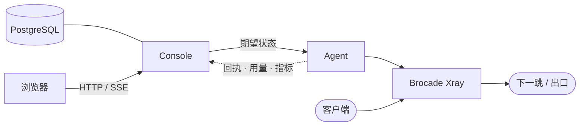

# Brocade

Brocade 是自建多地域 Xray 网络的声明式控制系统：用一份模型描述机器、线路、用户与授权，把模型确定性地编译成每台机器的配置，再由机器上的 Agent 持续收敛。

[设计约束](#设计约束) · [架构](#架构) · [一次变更的路径](#一次变更的路径) · [失联时](#失联时) · [数据面](#数据面) · [试用](#试用) · [文档](#文档) · [仓库](#仓库)

## 为什么是声明式

管理几十台代理机器，难点很少是写出一份配置，而是回答这些问题：这次改动会影响哪些机器？线上实际运行的是哪个版本？出了问题能否准确回到之前的状态？某台机器失联期间发生了什么？

Brocade 的做法是：所有意图写进同一份模型；配置由模型推导，从不手工维护；每次发布都指向一个不可变的修订；机器只接收“应当是什么样”，自己负责“变成那样”。

## 设计约束

1. **编译是纯函数。** `brocade-core` 不访问数据库、文件系统或网络；相同版本和输入产生逐字节一致的产物。发布预览、历史修订重编译和回归测试都建立在这一点上。
2. **修订不可变。** 编辑先进入草稿，提交后形成修订；回滚以历史修订为目标创建新的发布，不改写任何记录。
3. **收敛而非执行。** Agent 接收期望状态，与本机实际状态比较，只在有偏差时执行幂等操作；中断后重试即可恢复。
4. **拓扑由规则推导。** 线路路径来自入口位置、逐跳转发规则和监听引用，不另存一份可能与规则矛盾的拓扑。
5. **发布分域。** 配置、授权、Agent、Xray 与 Console 各有独立的发布路径和回滚方式，风险与代价不同，互不顺带。

## 架构



Console 是唯一的控制入口：保存草稿、修订与发布记录，编译产物，默认用同一个端口服务浏览器与 Agent。Agent 主动轮询期望状态，实时数据经 WebSocket 上行；浏览器只通过 Console 的 SSE 读取，从不直接连接机器。

## 一次变更的路径

1. 在控制台编辑，改动写入草稿；一次界面操作涉及的多张表在同一事务中修改。
2. 提交草稿得到不可变修订。Console 编译出每台机器的产物，并与当前线上修订比较。
3. 发布按影响范围分成波次，含破坏性操作的波次等待操作者确认。
4. Agent 轮询到新的期望状态后在本机收敛：能热更新的经 Xray API 完成，结构变化由新旧进程交接监听；条件不足时保留旧进程并报告失败，而不是断流重启。
5. Agent 回报执行回执，全部目标确认后发布完成。

授权变更不走这条路径：Console 只比较账户投影，排队后由 Agent 直接更新运行中 Xray 的用户，不生成完整配置。

## 失联时

- Agent 把最近一次期望状态保存在本地，控制面不可达时仍能纠正本机漂移。
- 用量和指标先写入本地有界队列，恢复后按序补报；重复窗口由数据库去重，不会重复记账。
- 实时速率只在有人查看时采集，不落库，也不参与补报。
- 连续 90 秒没有轮询的机器记为下线，并产生通知。

## 数据面

Brocade 只支持仓库内维护的 Xray fork（[`components/xray-core`](components/xray-core)，上游基线 v26.4.25）。它在上游之上增加了 AnyTLS、MTProxy、进程间监听交接、按用户撤销会话和站点用量统计等能力。Console 构建时把双架构的 Xray 嵌入自身，并以实际字节的摘要作为发布身份。

| 环节 | 支持 |
| --- | --- |
| 接入 | VLESS（REALITY / TLS，TCP / XHTTP）、AnyTLS、Hysteria2、MTProxy |
| 中转 | VLESS Encryption、REALITY、Shadowsocks 2022、WireGuard |
| 出口 | 直连、自定义隧道、Cloudflare WARP（MASQUE）、VPN Gate |

## 试用

从 [Releases](https://github.com/akiasprin/brocade/releases/latest) 下载与服务器匹配的安装包，校验后运行：

```sh
sudo sh brocade-dist-<版本>-linux-<arch>-<libc>/install.sh
```

安装器可托管 PostgreSQL，启动后输出初始化链接，入门向导带你纳管第一台机器。完整步骤见[安装与升级](docs/install.md)。

> [!IMPORTANT]
> Agent 以 root 身份修改机器的网络与系统配置。用于生产前，请先审查生成的配置、访问控制和部署边界。

## 文档

- [安装与升级](docs/install.md)：发行包、安装器、初始化、升级与备份
- [手动部署](docs/manual-deployment.md)：不使用安装器，以 systemd 与 Nginx 部署
- [从源码构建](docs/build.md)：前置条件、发行构建、本地前端开发
- [模型、修订与发布](docs/concepts.md)：编译、草稿与修订、授权、机器隔离、发布单
- [接入与出口](docs/routing.md)：REALITY 回落、TCP 保活、WARP、出口拨测
- [VPN Gate](docs/vpngate.md)：目录采集、候选资格、IP 情报、主备切换
- [用户、访问与订阅](docs/users.md)：会话与访客、订阅、接入配额、在线设备
- [端口转发](docs/forwarding.md)：地址防护、用量与配额
- [用量与实时流量](docs/traffic.md)：用量账本、实时速率、机器流量统计
- [出流量统计](docs/site-usage.md)：站点分类、其他站点与嗅探失败目标
- [机器观测与通知](docs/observability.md)：指标、Ping、公网 IP、通知、日志、性能诊断

## 仓库

| 路径 | 职责 |
| --- | --- |
| `crates/brocade-core` | 纯函数编译器：模型快照 → IR → 节点产物；Golden 产物在 `tests/golden/` |
| `crates/brocade-store` | PostgreSQL：草稿、修订、发布、凭据、配额与用量 |
| `crates/brocade-console` | 管理端与节点端 API、实时通道；内嵌前端、Agent 与 Xray |
| `crates/brocade-deployment` | 发布计划与 Console / Agent 共享协议 |
| `crates/brocade-agent` | 机器侧收敛、观测、探测、自更新与离线缓冲 |
| `crates/brocade-probe` | Console 与 Agent 共用的临时 Xray 拨测 |
| `crates/brocade-launcher` | `brocade` 命令：启动 Console 与托管 PostgreSQL |
| `crates/brocade-sqlx` | 只含 PostgreSQL 驱动的 SQLx 门面 |
| `crates/brocade-preview` | 基于 Docker 的本地集群预览 |
| `frontend` | React + Vite 控制台 |
| `components/xray-core` | Brocade Xray fork |

```sh
cargo test --workspace --locked
cd frontend && npm ci && npm test
```

构建见[从源码构建](docs/build.md)；验证矩阵与工程约定见 [AGENTS.md](AGENTS.md) 和 [`.agents/`](.agents/README.md)。

## 许可证

Brocade 自有代码采用 [Apache License 2.0](LICENSE)。`components/xray-core` 是 [Xray-core](https://github.com/XTLS/Xray-core) 的 fork，遵循 [MPL-2.0](components/xray-core/LICENSE)，固定的上游基线见 [BROCADE_UPSTREAM.toml](components/xray-core/BROCADE_UPSTREAM.toml)。
